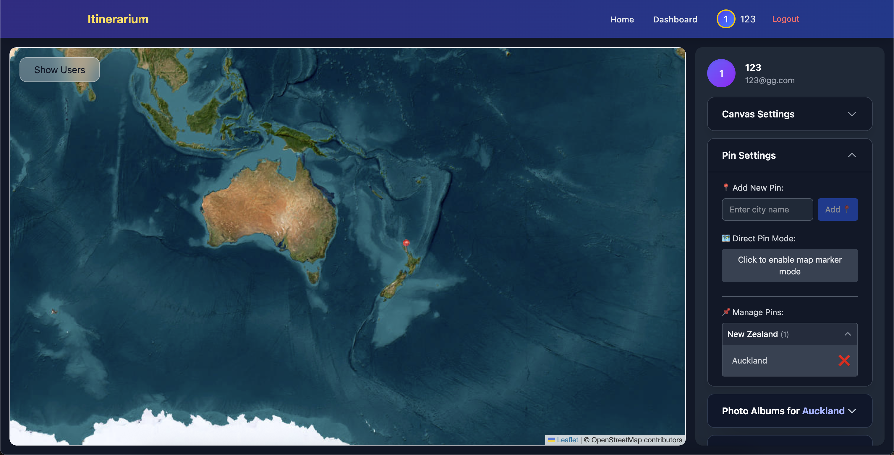
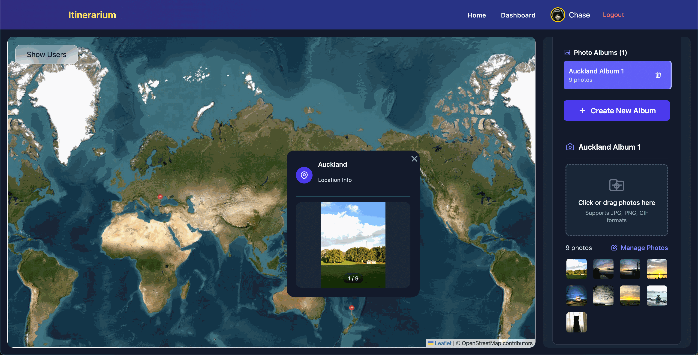
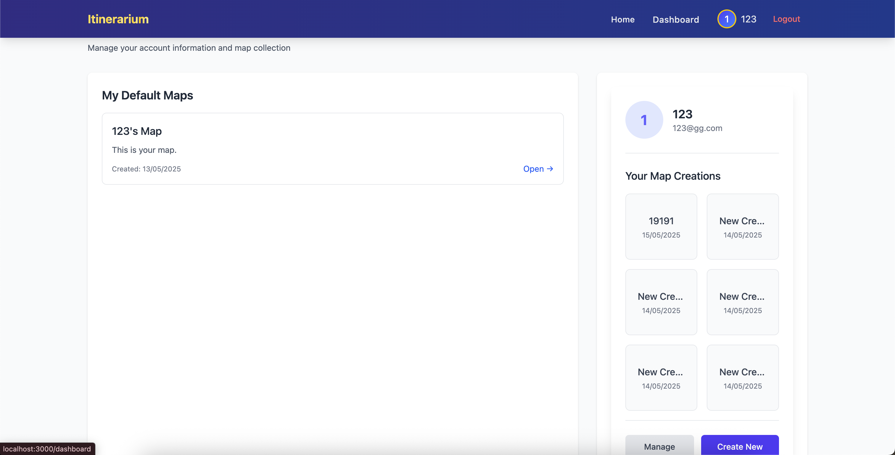
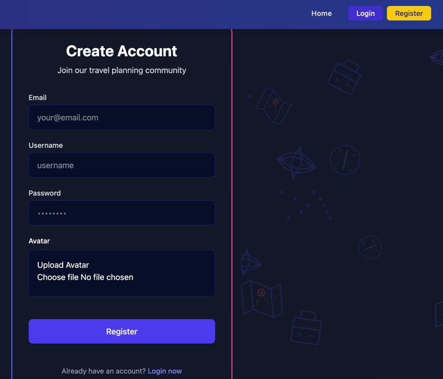
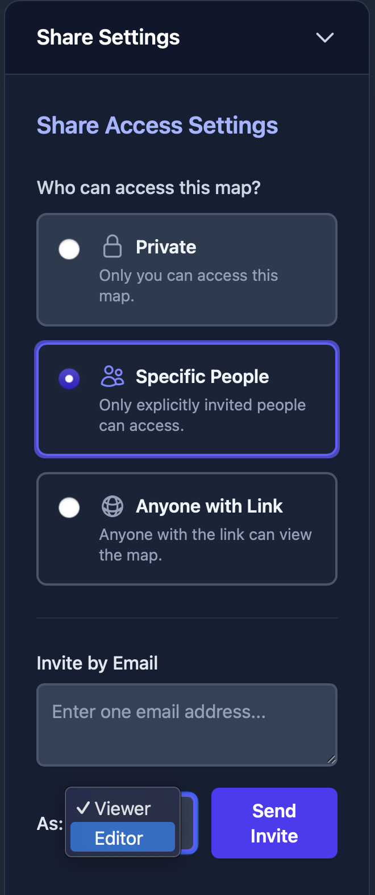

# Itinerarium

A travel-map web application for recording journeys, managing location pins and photo albums, and sharing maps with collaborators.

This repository is a personal continuation of the University of Auckland CS732 Team Hooks Squad project. The imported code is the starting baseline; future changes will be recorded in this repository's new Git history. See [PROVENANCE.md](PROVENANCE.md) for its origin and licensing status.

## Stack and features

- Next.js 15, React 19, TypeScript, Tailwind CSS and React Leaflet
- Express 5, TypeScript, MongoDB/Mongoose and Socket.IO
- User registration/login, map and pin management, image uploads, sharing and collaborative updates
- Jest/Supertest backend tests

These describe the inherited application, not a claim that all features were independently authored or verified in this continuation.

## Screenshots

Original course-project screenshots extracted from Guang Liu's individual report (Figures 3-6 and 10). They show the application at the time of the report; they are not screenshots of the latest local verification run.

### Interactive map and location pins



### Photo albums



### Dashboard



### Account registration



### Sharing settings



## Local development

Use Node.js 22 LTS and npm. Both applications include lockfiles; install with `npm ci`. A local MongoDB instance is required to run the backend. The ports below avoid the common frontend port 3000.

From the repository root, prepare your local configuration:

```bash
cp backend/.env.example backend/.env
cp frontend/.env.example frontend/.env.local
```

In `backend/.env`, replace the JWT placeholder with a random secret (generate one with `openssl rand -hex 32`). Set your own MongoDB connection string if needed. In `frontend/.env.local`, supply your own OpenRouteService key for location search. `NEXT_PUBLIC_*` variables are visible in the browser; do not put private server credentials in them.

Backend terminal, from the repository root:

```bash
cd backend
npm ci
npm run dev
```

Frontend terminal, from the repository root:

```bash
cd frontend
npm ci
npm run dev -- --port 7392
```

Open http://localhost:7392. The backend uses port 7393 in the supplied environment template. Keep the frontend API and WebSocket URLs aligned with that port. Local `.env` files are ignored by Git.

## Verification commands

From `backend/`:

```bash
npm run build
npm test -- --runInBand
npm run lint
```

From `frontend/`:

```bash
npx tsc --noEmit
npm run lint
npm run build
```

Type and lint checks are enabled during Next.js builds. `npm run lint` runs ESLint with zero warnings allowed, excluding generated output. There is no frontend test script. Some backend tests download a temporary MongoDB binary through `mongodb-memory-server`.

## Containers

`compose.example.yaml` and the Dockerfiles are inherited development scaffolding, not a production deployment. They use ports 3000/3001, placeholder credentials and development servers. If used, copy the example to ignored `compose.yaml`, replace the placeholders and review port mappings. No live deployment is configured or claimed by this repository.

## Layout

- `frontend/src/`: pages, map components, API clients, contexts and hooks
- `backend/src/`: routes, controllers, services, models, WebSockets and tests
- `frontend/public/`: inherited UI artwork
- `backend/public/uploads/test/`: inherited test fixture

Before any public release, review the inherited artwork, team image and licensing status described in [PROVENANCE.md](PROVENANCE.md).
